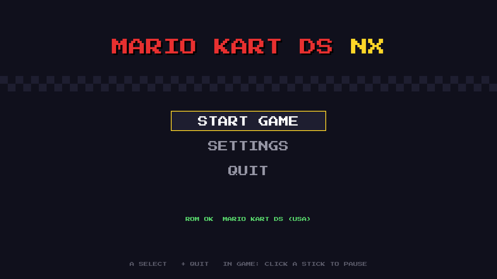
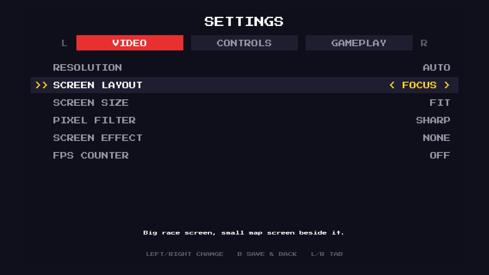
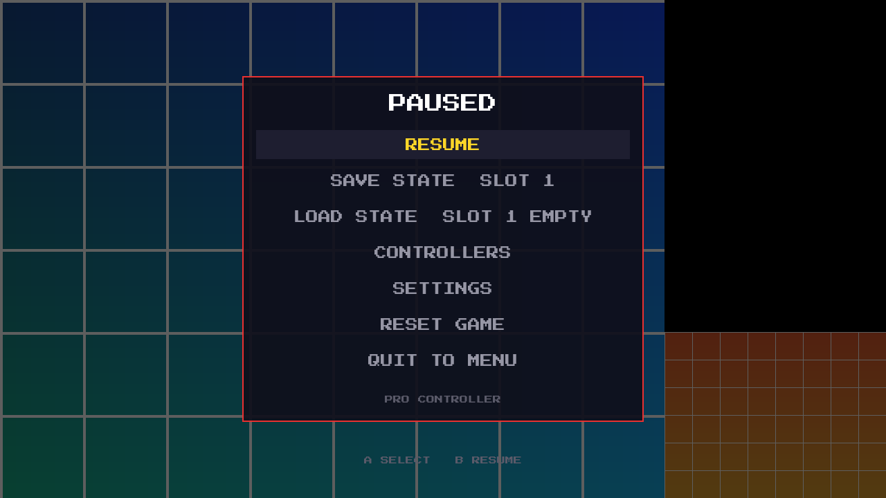
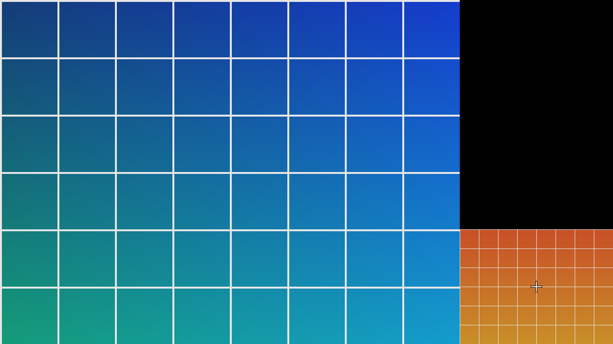
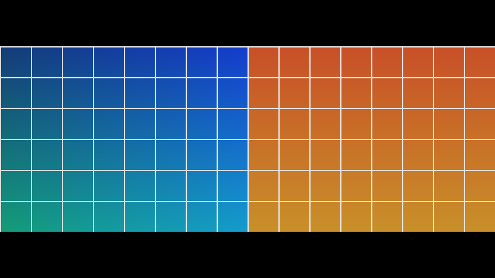
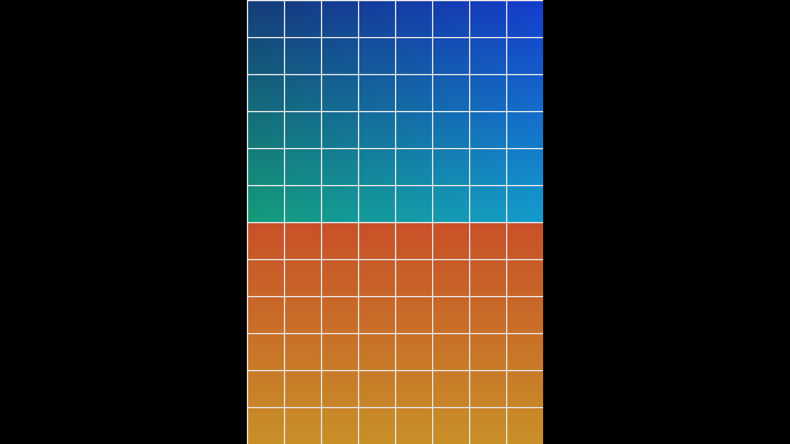
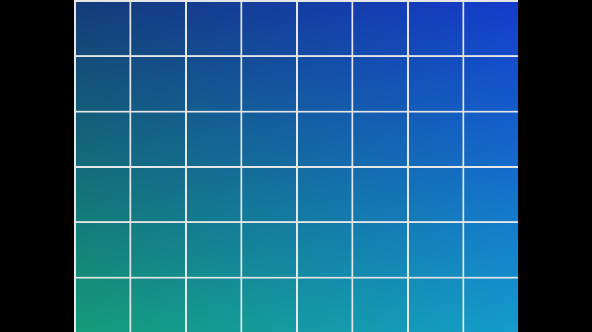

# Mario Kart DS NX

A Nintendo Switch homebrew launcher for **Mario Kart DS (USA)**, built on the
melonDS emulator core. It runs your own copy of the game with a custom 8-bit style menu,
dual-screen layouts, touch-screen support, save states and fast-forward.

> **No game files are included.** You must provide your own legally obtained ROM dump.
> This project is not affiliated with or endorsed by Nintendo.

<p align="center">
  
  
  
</p>

## Features

- Custom boot menu: Start Game, Settings, Quit
- Four dual-screen layouts: Focus (big race screen, small map), Side by Side, Stacked,
  and One Screen, with a button to swap the screens at any time
- Touch input: tap the bottom screen in handheld mode, or use a right-stick cursor when docked
- Display options: resolution (auto 720p/1080p), screen size (fit, integer, 90/80/70%),
  pixel filter, LCD grid effect
- FPS counter in any corner
- 4 save-state slots plus automatic in-game saves (records, unlocks)
- Fast-forward at 2x, 3x or 4x
- Full button remapping, including swap screens, touch and microphone (blow)
- Cheat toggles loaded from a text file (Action Replay DS codes)
- Performance: ARM64 JIT, CPU boost to 1785 MHz while playing, and emulation and
  3D rendering on separate CPU cores

<p align="center">
  
  
  
  
</p>
<p align="center"><sub>Focus, Side by Side, Stacked and One Screen (shown with a test pattern)</sub></p>

## Requirements

- A Nintendo Switch that can run homebrew (Atmosphère custom firmware)
- A dump of **Mario Kart DS (USA)** in `.nds` format, game code `AMCE`, about 32 MB

## Installation

1. Download `mkds-nx.nro` from the [latest release](../../releases/latest).
2. On your SD card, create the folder `/switch/mkds-nx/`.
3. Copy `mkds-nx.nro` into it.
4. Copy your ROM into the same folder and name it exactly `mkds.nds`.

```
SD card
└── switch
    └── mkds-nx
        ├── mkds-nx.nro
        └── mkds.nds
```

5. On the Switch, **hold R while launching any game** to open the Homebrew Menu in full
   application mode, then launch **Mario Kart DS NX**.

Launching from the Album (applet mode) is not supported: there isn't enough memory, so
the app will ask you to relaunch.

**macOS users:** after copying files, run `dot_clean -m /Volumes/<SD card name>` in
Terminal and eject the card properly, so hidden `._` files don't confuse the Switch.

The main menu shows a green **ROM OK** line when your ROM is detected correctly. Other
regions or modified dumps still boot, with a yellow warning.

BIOS and firmware files are optional. melonDS has a built-in replacement that runs the
game. If you have dumps from your own DS, put `bios7.bin`, `bios9.bin` and
`firmware.bin` in the same folder.

## Controls

| Switch | Action |
|---|---|
| A / B | DS A (accelerate) / B (brake) |
| L / R | DS L (use item) / R (hop / drift) |
| X / Y | DS X / Y |
| + / − | Start / Select |
| D-pad or left stick | Steer / navigate |
| ZL | Swap screens |
| Touch screen (handheld) | Tap the bottom screen |
| Right stick + ZR | Move the stylus cursor + tap (docked) |
| Click either stick | Pause menu |
| Hold the right stick to the right | Fast-forward |

All buttons can be remapped in **Settings › Controls**, including a **Microphone** button
for blowing up balloons in Balloon Battle. It is unbound by default.

## Settings

| Tab | Options |
|---|---|
| Video | Resolution, Screen Layout, Screen Size, Pixel Filter, Screen Effect, FPS Counter |
| Controls | Every DS button, Swap Screens, Touch, Microphone, Reset to Defaults |
| Gameplay | Fast-Forward, Language, CPU Mode, CPU Clock, cheats |

- **CPU Mode: Fast (JIT)** is needed for full speed. If the game ever crashes, the next
  launch says so on the title screen; switch to **Safe** if it keeps happening.
- **CPU Clock: 1785 MHz** is the clock the Switch itself uses while loading games. The
  app raises it only while you're playing (not in menus or the HOME menu). Choose
  **Stock** to save battery. If you use sys-clk, it may override this.

## Files created by the app

These appear in `/switch/mkds-nx/` next to the app:

| File | Purpose |
|---|---|
| `config.ini` | Your settings. Delete it to reset to defaults. |
| `cheats.txt` | Your cheat codes, one per line as `Name = CODE`. Starts with instructions only. |
| `mkds.sav` | In-game save: records, ghosts, unlocks. **Back this up.** |
| `mkds.state1`–`mkds.state4` | Save-state slots from the pause menu. |
| `log.txt` | Log of the last run. Attach it when reporting a bug. |

## Cheats

Open `cheats.txt` on your computer and add lines like:

```
My Cheat Name = 12345678 00000000+D2000000 00000000
```

Codes are Action Replay DS format (pairs of 8-digit hex numbers), made for the USA
version. Join the lines of a multi-line code with `+`. Then turn the cheat on in
**Settings › Gameplay**; it applies the next time you start the game.

## Building from source

The easiest way is with Docker and the official devkitPro image:

```
git clone --recursive https://github.com/sylvyrbullyt/mkds-nx.git
cd mkds-nx
docker run --rm -v "$PWD":/src -w /src devkitpro/devkita64 make
```

This produces `mkds-nx.nro`. The first build applies `patches/melonDS-switch.patch` to the
melonDS submodule and builds the core as a static library (with the ARM64 JIT, without
OpenGL), which takes a few minutes. Without Docker, install devkitPro with the
`switch-dev`, `switch-sdl2` and `switch-sdl2_ttf` packages and run `make`.

`tools/preview.cpp` renders the menus and layouts on a desktop computer for quick design
checks (build instructions are at the top of the file).

## Credits and licenses

- **melonDS** emulator core (libretro port): https://github.com/libretro/melonDS,
  licensed under the GNU GPL v3. Because the app links melonDS, Mario Kart DS NX is
  also licensed under the **GPL v3** (see `LICENSE`).
- **Press Start 2P** font by Cody "CodeMan38" Boisclair, under the SIL Open Font License
  (`romfs/fonts/OFL.txt`).
- Built with [devkitPro](https://devkitpro.org), libnx and SDL2.

Mario Kart DS is a trademark of Nintendo. This project contains no Nintendo code or assets.
